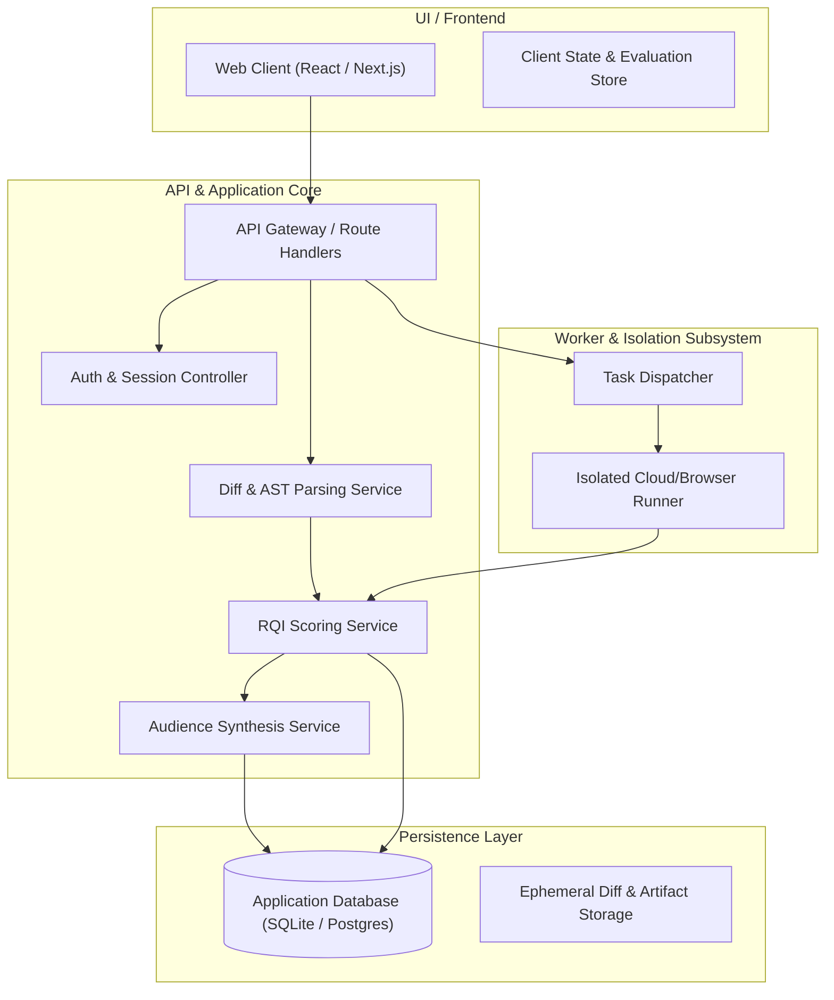

# System Architecture — ReleaseLens

> **Document Status**: `INITIAL BASELINE` / `PROPOSED`  
> **Last Synchronized**: 2026-11-03  

---

## 1. High-Level Architecture

ReleaseLens is architected as a modular, full-stack application designed for high-density information display, secure data parsing, and isolated verification workloads.

---

## 2. Subsystem Descriptions

### 2.1 Web Frontend
- Modern UI built with TypeScript, React, and Tailwind CSS.
- Optimized for engineers and product managers: clean typography, zero visual clutter, data-dense inspector panels, and instant responsive feedback.
- Accessible keyboard navigation and strict high-contrast readability.

### 2.2 Core Analysis Engine
- **Diff Ingestion**: Safely strips out sensitive binary files and large lockfile noise while isolating high-impact code hunks.
- **AST / Heuristic Classifier**: Detects database schema changes, route changes, breaking API signatures, and dependency modifications.
- **Deterministic RQI Calculator**: Implements the mathematical formulas documented in `docs/RQI_SCORING.md`.

### 2.3 Cloud / Browser Worker
- Designed to execute synthetic smoke checks and headless verification flows in an isolated sandbox.
- Restricts filesystem access, prevents network escape, and captures strict timeout/memory metrics. Details in `docs/CLOUD_WORKER.md`.

### 2.4 Data & State Persistence
- Release histories, RQI reports, and configured gating policies are stored in a relational schema.
- Data retention rules ensure transient diff data can be scrubbed while retaining audit summaries.
