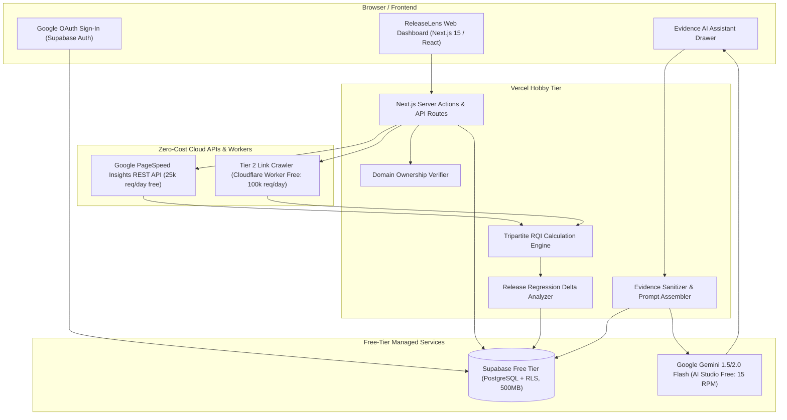

# System Architecture — ReleaseLens

> **Document Status**: `SYNCHRONIZED` / `FINAL DRAFT (ROUND 5)`  
> **Last Synchronized**: 2026-11-03  

---

## 1. System Topology Overview

ReleaseLens is architected as a modular, decoupled cloud system operating strictly on free-tier infrastructure with zero machine-local dependencies and zero payment requirements:

---

## 2. Component Boundaries & Responsibilities

1. **Next.js Web Dashboard (Vercel Hobby)**:
   - Manages UI rendering, user authentication sessions, domain registration, and audit telemetry.
   - Strictly conforms to Vercel personal/non-commercial fair-use rules by performing zero outbound scraping.
2. **Domain Ownership Verifier**:
   - Executes single HTTP GET requests to check `<meta name="releaselens-verification">` or `/.well-known/releaselens-verify.txt`.
   - Enforces origin matching and rejects cross-domain redirects.
3. **Cloudflare Worker Link Crawler (Tier 2)**:
   - High-throughput, low-latency edge worker deployed on Cloudflare Free Plan (100k requests/day).
   - Receives target URL, spiders up to 15 internal links within the same origin, tests for 404/500 status codes, and returns broken link telemetry in $<800\text{ms}$. Consumes $<3\text{ms}$ CPU time.
4. **Google PageSpeed API (Tier 1)**:
   - Direct REST API integration retrieving mobile/desktop Lighthouse metrics (Performance, Accessibility, Best Practices, SEO) and Core Web Vitals.
5. **Supabase PostgreSQL & Auth**:
   - Manages user accounts, registered sites, audit records, RQI breakdowns, and chat history. Enforces strict Row-Level Security (RLS).
6. **Gemini Flash Evidence AI Assistant**:
   - Read-only, toolless assistant answering user queries strictly from sanitized, delimited audit payloads.
