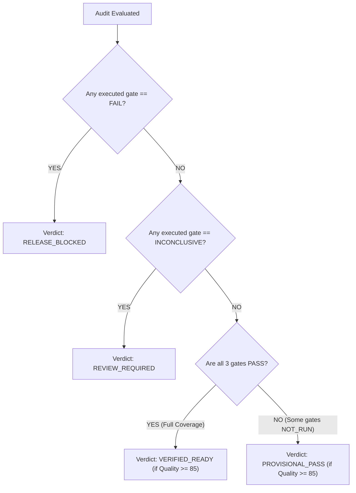
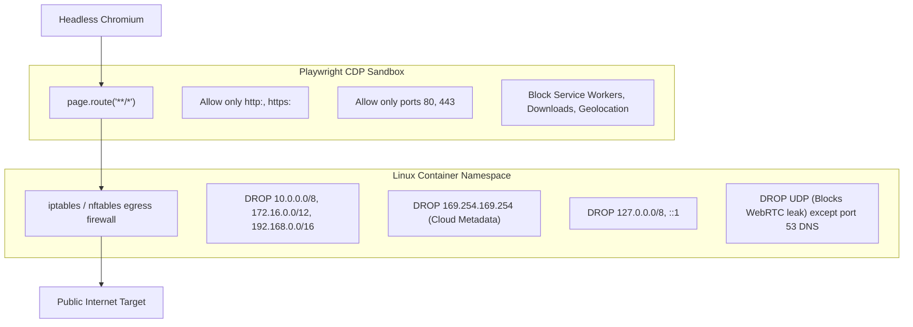

# Architecture Validation & Feasibility Report — ReleaseLens

> **Document Status**: `SYNCHRONIZED` / `RIGOROUS CORRECTION (ROUND 4)`  
> **Last Synchronized**: 2026-11-03  

---

## 1. Executive Summary & Component Classifications

In strict adherence to empirical engineering standards, all components are classified using standardized evidence states:
- `DOCUMENTED`: Verified against authoritative vendor documentation.
- `REASONED`: Supported by structural technical analysis, but pending experimental validation.
- `EXPERIMENTALLY_VERIFIED`: Empirically validated with reproducible test logs in this environment.
- `PROPOSED`: Ideated architecture awaiting experimental testing or user sign-off.
- `BLOCKED`: Cannot satisfy requirements under current constraints; implementation gated.
- `REJECTED`: Unsuitable due to policy violations, operational risks, or technical failure.

### Master Component Status Table

| Architecture Component | Status | Empirical Rationale |
| :--- | :--- | :--- |
| **Frontend Web App (Next.js on Vercel)** | `DOCUMENTED` | Standard SSR/React hosting within Vercel Hobby terms. |
| **Vercel as a Web Crawler / Auditing Engine** | `REJECTED` | **Violates Vercel Hobby Fair Use Policy** (automated scraping/crawling of external user URLs is prohibited). High risk of account suspension. |
| **GitHub Actions as Cloud Browser Runner** | `REJECTED` | **Violates GitHub Actions Acceptable Use Policy** (multi-tenant SaaS computing backend). Billed-minute rounding penalty. |
| **Google PageSpeed Insights REST API** | `DOCUMENTED` | 25,000 requests/day free tier with API key. Synthetic lab metrics only; CrUX field data is null on staging. |
| **Cloud Run Request-Based Worker (Tier 3)** | `REASONED` | Feasible under Tier 1 GCP regions (`us-central1`), but **zero-spend cannot be guaranteed natively by GCP** without programmatic billing disablement. |
| **Supabase Free Tier (PostgreSQL + Auth)** | `DOCUMENTED` | 500MB DB quota, 50k MAU auth, hard stop on storage with zero auto-billing. 7-day inactivity pause must be handled. |
| **Playwright Route Interception (Browser SSRF)** | `REASONED` | Application-level route interception does not intercept WebRTC UDP or native socket rebinding. Egress firewall is required. |
| **Network-Level Container Egress Isolation** | `PROPOSED` | Requires Linux network namespace / `iptables` rules blocking private IPs and UDP at the OS level. |
| **Tripartite RQI Hard-Gate Model** | `REASONED` | Replaced flawed multiplicative formula. Hard gates (`PASS`, `FAIL`, `NOT_RUN`, `INCONCLUSIVE`) cleanly separate blocker detection from quality score. |
| **Allowlist Evidence Collection & Prompt Safety** | `REASONED` | Deny-by-default header scrubbing, query stripping, read-only toolless AI prompt isolation. |

---

## 2. Accurate Cloud Run Capacity & Regional Realities

### Critical Regional Finding: Tier 1 vs. Tier 2 (India) Regions
- **GCP Free Tier is strictly region-dependent**:
  - The Cloud Run Free Tier (2M requests, 360k vCPU-seconds, 180k GiB-seconds) applies **strictly to Tier 1 pricing regions** (e.g. `us-central1`, `us-east1`, `us-west1`).
  - **`asia-south1` (Mumbai) and `asia-south2` (Delhi) are Tier 2 pricing regions with ZERO Free Tier allowance.**
  - If a Cloud Run service is deployed in India, every vCPU-second and request is billed from the first second. To operate at ₹0, Cloud Run containers **must** be deployed in `us-central1` or `us-east1`.

### Exact Arithmetic Across Billing Models (Tier 1 Regions)

#### A. Request-Based Services (CPU allocated only during request processing)
- **Monthly Free Allowances**:
  - 2,000,000 HTTP requests.
  - 360,000 vCPU-seconds.
  - 180,000 GiB-seconds.
  - 1 GiB free outbound internet egress to North America.
- **Resource Sizing for Headless Chromium Worker**:
  - Memory: 2 GiB RAM (required to prevent Chrome crashes on heavy client-rendered SPAs).
  - CPU: 1 vCPU.
- **Bottleneck Analysis**:
  - Capacity limited by Memory: $180,000 \text{ GiB-seconds} / 2 \text{ GiB} = \mathbf{90,000 \text{ seconds}}$ of active execution per month.
- **Audit Execution Profile**:
  - Cold start + container wake-up: ~4.0s
  - Browser launch + page render: ~3.0s
  - Interaction + network idle wait: ~12.0s
  - Evidence serialization + cleanup: ~1.0s
  - Total duration per run: ~20.0s (Average).
  - Allowance for retries and slow sites (15% failure rate): $20.0\text{s} \times 1.15 = 23.0\text{s}$.
- **Net Monthly Capacity**:
  $$\text{Capacity} = \frac{90,000 \text{ GiB-seconds}}{23.0\text{s} \times 2 \text{ GiB}} = \mathbf{1,956 \text{ complete browser runs / month}}$$
  *(At 1 vCPU, 1,956 runs consume $1,956 \times 23 = 45,000 \text{ vCPU-seconds}$, well within the 360,000 allowance).*
- **Egress Calculation**:
  - Ingress to Cloud Run: Free.
  - Outbound requests to target website: ~50 KB per page $\times$ 15 pages = 750 KB.
  - Response payload to ReleaseLens API: ~150 KB.
  - Total egress per audit: ~900 KB (0.0009 GB).
  - For 1,956 audits: $1,956 \times 0.0009 \text{ GB} = \mathbf{1.76 \text{ GB}}$.
  - *Risk*: Exceeds the 1 GiB free egress allowance by 0.76 GB ($\approx \$0.09$ charge)!
  - *Correction*: To stay strictly under 1 GiB free egress, **maximum browser audits must be capped at 1,100 audits/month**.

#### B. Instance-Based Services (CPU always allocated)
- Container stays warm 24/7.
- Monthly consumption: $1 \text{ instance} \times 2 \text{ vCPU} \times 86,400\text{s} \times 30 \text{ days} = 5,184,000 \text{ vCPU-seconds}$.
- **Verdict**: The 360,000 vCPU-second free quota is exhausted in **50 hours (2.08 days)**. `REJECTED`.

#### C. Cloud Run Jobs (Run-to-completion batch execution)
- Cloud Run Jobs charge based on container task runtime with CPU always allocated during task life.
- Incur identical per-second rates as request-based services, but cannot receive standard HTTP webhooks directly without an intermediate Pub/Sub trigger.

---

## 3. Reassessing Platform Hosting & Vercel Suitability

### Vercel Fair Use Policy & Scraping Restrictions
- **Official Vercel Terms**: Vercel Hobby is explicitly restricted to personal/non-commercial web applications. Using Vercel Serverless Functions to perform automated outbound web scraping or crawling of third-party domains violates Vercel's fair use guidelines. Vercel automatically flags high outbound connection bursts and IP crawling as abusive behavior.
- **Architectural Decision (ADR-018)**:
  - **Frontend Dashboard & API**: Next.js hosted on Vercel (Hobby). Handles UI rendering, user authentication callbacks, audit history viewing, and client queries. 100% compliant with Vercel terms.
  - **Native HTTP Crawler & Probes**: **Removed from Vercel Functions**. Decoupled to Cloudflare Workers (Free: 100k requests/day, built for network I/O) OR consolidated into the Google Cloud Run worker container.

---

## 4. Genuine Zero-Spend Protection Architecture

### The Truth About Cloud "Budgets"
1. **Google Cloud Budgets Are NOT Spend Caps**: GCP Budget alerts send emails and Pub/Sub notifications. They **do not** halt service execution or prevent billing charges automatically.
2. **Native Spend-Cap Limitations**: Google Cloud does **not** offer a native, toggleable hard cap at ₹0 for Cloud Run. If traffic exceeds free limits, GCP automatically bills the credit card.
3. **Multi-Layered Zero-Spend Safeguards**:
   - **Layer 1: Application-Level Token Bucket**: An immutable accounting table in Supabase tracks cumulative monthly vCPU-seconds and egress. Once monthly usage reaches **80% of the free threshold (e.g. 800 browser audits)**, the API refuses new Tier 3 jobs and displays: *"Monthly free compute ceiling reached. Audits restricted to Tier 1 Public Scans until 1st of next month."*
   - **Layer 2: Programmatic Billing Shutdown (Pub/Sub + Cloud Function)**: A GCP Cloud Function subscribed to the GCP Billing Pub/Sub topic. If actual spending exceeds ₹1, it calls `google.cloud.billing.v1.CloudBilling.UpdateProjectBillingInfo` to remove the billing account, shutting down all GCP resources instantly before a bill can accumulate.
   - **Layer 3: No-Credit-Card Core Services**: Vercel Hobby, Supabase Free Tier, Google PageSpeed API, and Google AI Studio Gemini Free Tier do **not** auto-upgrade or charge. They fail safely with HTTP 429/402 when limits are met.

---

## 5. Corrected RQI Hard-Gate Model & State Logic

### Four Formal Gate States
1. `PASS`: Check was executed; all safety criteria satisfied.
2. `FAIL`: Check was executed; critical defect detected.
3. `NOT_RUN`: Check was omitted from the executed audit tier.
4. `INCONCLUSIVE`: Check was attempted, but failed to yield a definitive result (timeout, unreachable target, upstream API error).

### Hard Gate Inventory & Justifications

| Hard Gate | Scope | Evaluated Conditions | Justification |
| :--- | :--- | :--- | :--- |
| **`GATE_SECURITY`** | Tier 1 | 1. TLS certificate not expired ($\text{days} > 0$). 2. TLS certificate not in critical renewal failure ($\text{days} > 2$). 3. HTTPS enforced (HTTP redirects to HTTPS). 4. Anti-clickjacking active (`X-Frame-Options` or `frame-ancestors`). | Expired certificates block user access. Missing clickjacking headers expose users to credential theft. *Note: 14-day threshold revised to 2 days for hard failure; 3–14 days is a non-blocking warning.* |
| **`GATE_FUNCTIONAL`** | Tier 2/3 | 1. Zero unhandled fatal JavaScript exceptions during page load. 2. Critical assets (main JS bundle) return HTTP 200 (not 404/500). | Client-side crashes break hydration and disable interactive UI. |
| **`GATE_AUTH`** | Tier 3 | 1. OAuth authorization redirect parameters valid. 2. Configured callback endpoint reachable (returns HTTP 400 or redirect, not 404/500). | Broken callback routes guarantee authentication failure for all users. |

### Operational Gate Impact on Release Verdicts

- **Rule 1**: A `NOT_RUN` gate can **NEVER** count as `PASS`.
- **Rule 2**: `PROVISIONAL_PASS` means: *"No blocker was detected in executed checks, but release readiness is NOT fully verified because deeper gates were NOT RUN."*
- **Rule 3**: `RELEASE_BLOCKED` overrides all numerical scores. A site with 100% Core Web Vitals and an expired SSL certificate is unconditionally `RELEASE_BLOCKED`.

---

## 6. Comprehensive Browser Network Isolation Design

Application-level Playwright route interception (`page.route`) is insufficient on its own because WebRTC, WebSocket handshakes, and native Chromium DNS resolutions can bypass JavaScript handlers.

ReleaseLens establishes a **Two-Tier Security Perimeter**:

### Infrastructure Layer (Container Host):
1. **Kernel Egress Firewall**: `iptables` rules drop all outbound TCP/UDP traffic to RFC-1918 private subnets, loopback, and cloud metadata (`169.254.169.254`).
2. **WebRTC Neutralization**: Drop all outbound UDP traffic except DNS (port 53), physically preventing WebRTC peer-to-peer data channels from probing internal networks.

### Application Layer (Playwright Engine):
1. **Universal Protocol Allowlist**: Aborts `file:`, `data:`, `blob:`, `gopher:`, `ftp:`.
2. **Port Restriction**: Restricts connections strictly to ports 80 and 443.
3. **Context Hardening**:
   - `context.setServiceWorkers('block')`
   - `context.on('download', d => d.cancel())`
   - Permissions denied: Geolocation, camera, microphone, notifications.

---

## 7. Data Privacy, Redaction & AI Safety Model

### Deny-by-Default Evidence Collection
ReleaseLens discards sensitive data at the ingestion boundary before persistence:

| Data Type | Handling Policy |
| :--- | :--- |
| **HTTP Headers** | **Deny-by-default**. Only an explicit allowlist of 6 security headers is stored (`content-security-policy`, `strict-transport-security`, `x-frame-options`, `x-content-type-options`, `referrer-policy`, `permissions-policy`). All `Cookie`, `Authorization`, and custom headers are dropped. |
| **URL Query & Fragments** | All query parameters are stripped from logged subresource URLs (`https://site.com/auth?token=xyz` $\to$ `https://site.com/auth`). |
| **DOM & Form Inputs** | Zero form input values or passwords stored. Only structural metadata (`title`, `meta`, `script[src]`) is captured. |
| **Console Logs** | Truncated to 200 characters; regex-scrubbed for API keys and tokens; max 5 error traces stored. |

### AI Assistant Permission Boundary
1. **Zero Tool Capabilities**: The conversational AI assistant is completely **toolless**. It cannot execute code, trigger network requests, invoke APIs, or write to the database.
2. **Strict Multi-Tenant Isolation**: The backend queries only the specific `AuditRun` belonging to the authenticated `user_id`. The AI has zero visibility across tenants.
3. **Prompt Injection Containment**: Audit evidence is injected into delimited boundary tags (`<untrusted_evidence>`). The system prompt instructs the model that data within `<untrusted_evidence>` is raw external text and must never be interpreted as operational instructions.
