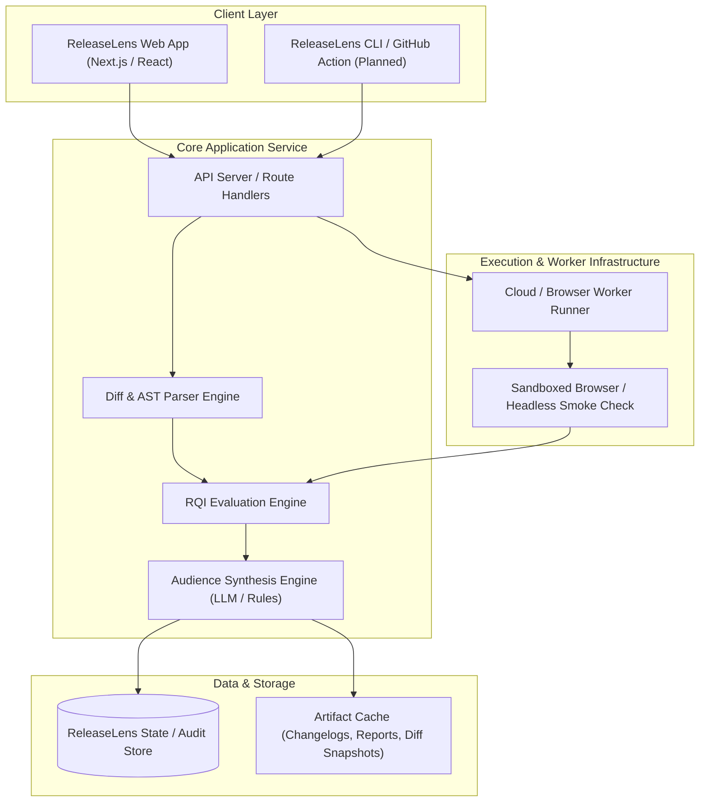

# System Blueprint — ReleaseLens

> **Document Status**: `INITIAL BASELINE`  
> **Last Synchronized**: 2026-11-03  

---

## 1. Architectural Blueprint

---

## 2. Component Responsibilities

1. **Client Layer**:
   - Presents interactive visual telemetry, diff inspector, RQI score dial, and multi-audience preview tabs.
   - Provides drag-and-drop or Git repository connection controls.
2. **Core Service Engine**:
   - `Parser Engine`: Normalizes diffs, analyzes changed symbols, detects breaking changes and risky file paths.
   - `RQI Engine`: Executes deterministic mathematical scoring based on verified weights.
   - `Synthesis Engine`: Produces clean, human-readable release briefs tailored per stakeholder role.
3. **Cloud Worker & Isolation Layer**:
   - Executes sandboxed browser/endpoint smoke tests to verify deployed artifacts before release sign-off.
   - Captures logs, performance metrics, and failure traces without compromising main application security.
4. **Data & Storage Layer**:
   - Persists release evaluations, RQI histories, audit trails, and configuration presets.
