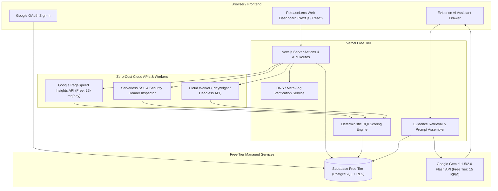

# System Blueprint — ReleaseLens

> **Document Status**: `SYNCHRONIZED`  
> **Last Synchronized**: 2026-11-03  

---

## 1. Cloud-Only Architecture Blueprint

---

## 2. Key Component Responsibilities

1. **Web Dashboard**: High-density interface for managing registered sites, initiating inspection runs, inspecting audit logs, viewing RQI breakdowns, and querying the AI assistant.
2. **Ownership Verification Service**: Validates domain ownership via HTML `<meta name="releaselens-verification" content="...">` or `https://<domain>/.well-known/releaselens-verify.txt`.
3. **Cloud Inspection Layer**:
   - Non-intrusive scans execute via Serverless HTTP workers and Google PageSpeed Insights API.
   - Deep and authenticated flows run in isolated cloud browser execution environments.
4. **Deterministic RQI Engine**: Aggregates all observed telemetry into a normalized 0–100 score.
5. **Evidence AI Engine**: Connects to the audit database to retrieve exact test logs and injects them into a strictly bounded prompt for Google Gemini API, ensuring zero hallucinated outcomes.
