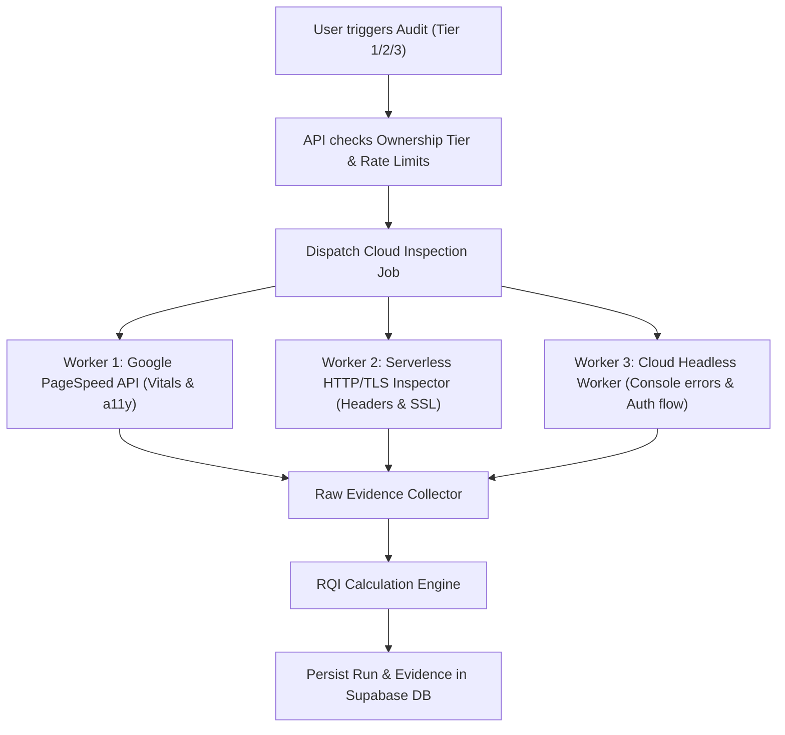

# Cloud Worker & Browser Inspection Architecture — ReleaseLens

> **Document Status**: `SYNCHRONIZED`  
> **Last Synchronized**: 2026-11-03  

---

## 1. Cloud Execution Mandate

In strict accordance with project requirements:
- **No local execution**: No Playwright or Puppeteer running on the user's personal development machine.
- **Zero Cost (₹0 Budget)**: Inspection jobs run in cloud environments utilizing free-tier compute:
  - **Tier 1 (Public)**: Direct API calls to Google PageSpeed Insights REST API + serverless Edge/Node HTTP workers (Vercel serverless functions).
  - **Tier 2 & 3 (Deep & Authenticated)**: Ephemeral cloud browser workers (e.g. `@sparticuz/chromium` in serverless function or free-tier container runner) bounded by strict 30-45s execution timeouts.

---

## 2. Worker Lifecycle & Evidence Ingestion

