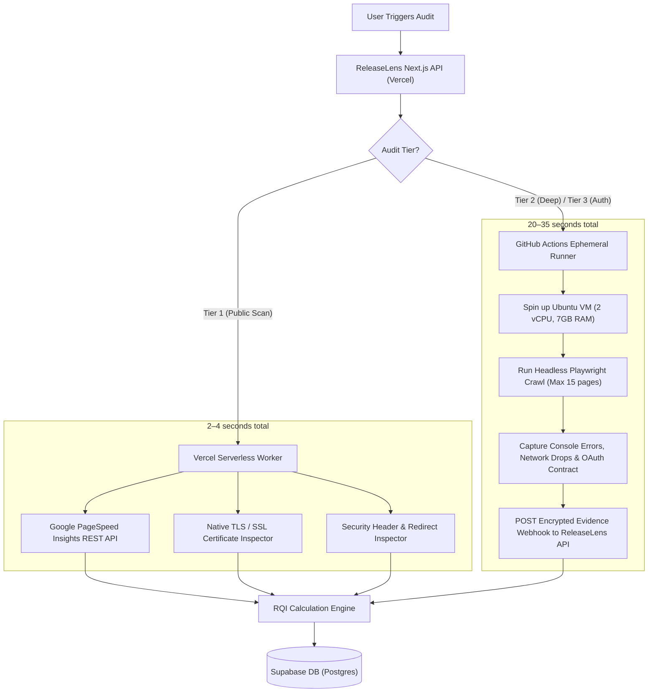

# Cloud Worker & Execution Architecture — ReleaseLens

> **Document Status**: `SYNCHRONIZED` / `REVISED SPECIFICATION`  
> **Last Synchronized**: 2026-11-03  

---

## 1. Cloud Provider Limits & Execution Feasibility

| Provider / Runtime | Free-Tier Limits | Browser Binary Support | Cold Start | Timeout Limit | Feasibility for Headless Browser |
| :--- | :--- | :--- | :--- | :--- | :--- |
| **Vercel Serverless (Hobby)** | 100k invocations/mo, 100 concurrent reqs | Compressing Chromium (`@sparticuz/chromium`) requires extracting brotli to `/tmp` (~50MB) | 4–8 seconds | 10s default (configurable to 60s) | **High Risk**: Prone to 504 timeouts on slow previews; Chromium cold start eats most of the execution budget. |
| **GitHub Actions Runner** | 2,000 Linux runner minutes/month (free on private, unlimited on public) | Full real Google Chrome & Playwright pre-installed in Ubuntu VM | 2–5 seconds queue time | 6 hours (we cap at 45s) | **Excellent**: Dedicated VM (2 vCPU, 7GB RAM), zero timeout danger, true OS isolation, 100% free. |
| **Cloudflare Workers** | 100k req/day free | Browser Rendering API requires paid plan ($5/mo) | N/A | 30s | **Ineligible**: Violates ₹0 budget requirement. |
| **Koyeb / Render Free Tier** | 1 web service, 512MB RAM | Docker container with Chromium | 30–50s (sleep on idle) | 30s | **Poor**: 512MB RAM causes Chrome out-of-memory crashes; high latency sleep wake-ups. |

---

## 2. Recommended Hybrid Execution Architecture

ReleaseLens implements a decoupled, two-tier execution pipeline:

---

## 3. Experimental Validation Plan

To validate this hybrid model prior to production rollout:
1. **Benchmark Vercel Serverless Probes**: Verify that native TLS inspection and PageSpeed REST API calls complete within 3 seconds across 20 distinct domains.
2. **Benchmark GitHub Actions Dispatch**: Test latency from API `repository_dispatch` trigger to webhook callback arrival. Expected: 18–30 seconds.
3. **SSRF Rebinding Verification**: Run automated regression test against a local DNS rebinding test server (`rbndr.us`) to confirm our socket-pinning agent blocks the connection before socket write.
