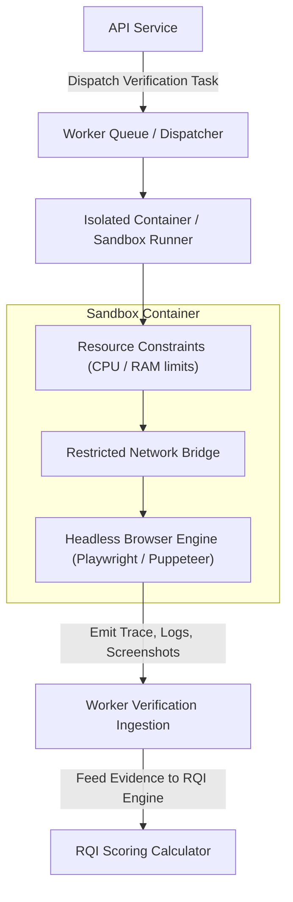

# Cloud Worker & Browser Isolation Design — ReleaseLens

> **Document Status**: `INITIAL BASELINE` / `PROPOSED`  
> **Last Synchronized**: 2026-11-03  

---

## 1. Overview & Objective

Release verification often requires executing dynamic checks that static diff analysis cannot confirm:
- Verifying that critical user journeys (e.g. login, payment flow, dashboard load) do not crash in a real browser.
- Running smoke tests against staging endpoints.
- Validating asset bundle sizes and performance regressions.

The **ReleaseLens Cloud Worker** is an isolated execution harness designed to safely run automated verification passes without endangering the host infrastructure.

---

## 2. Worker Architecture & Sandboxing

---

## 3. Security & Isolation Controls

1. **Zero Host Filesystem Access**: Workers operate inside ephemeral container environments or sandboxed node processes with zero write permissions to the host OS.
2. **Strict Timeouts**: Default execution budget is capped at 60 seconds per verification step to prevent runaway execution loops.
3. **Network Allowlisting**: Outbound requests from browser workers are restricted strictly to targeted staging URLs or local test harnesses.
4. **Secret Redaction**: Any environment tokens or secrets passed into the worker context are masked in output logs and traces.
