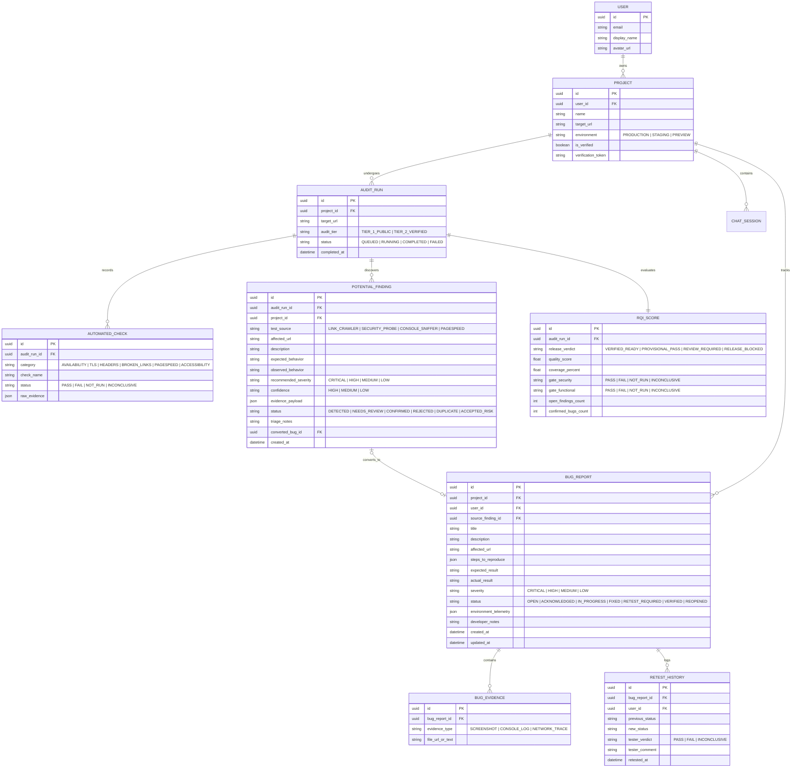

# Data Model & Schema — ReleaseLens

> **Document Status**: `SYNCHRONIZED` / `AUTOMATE FIRST, HUMAN REVIEW SECOND`  
> **Last Synchronized**: 2026-11-03  

---

## 1. Entity-Relationship Overview

---

## 2. Row-Level Security (RLS) Policies

All tables enforce strict Row-Level Security:
1. **`PROJECT`**: Select/Insert/Update/Delete where `user_id = auth.uid()`.
2. **`POTENTIAL_FINDING` & `BUG_REPORT`**: Access scoped to projects owned by `auth.uid()`, OR viewable via public read-only share token if the owner generates a shareable report permalink.
3. **`AUDIT_RUN` & `AUTOMATED_CHECK`**: Scoped to the parent project's owner.
4. **`CHAT_SESSION`**: Strictly restricted to `auth.uid()`.
