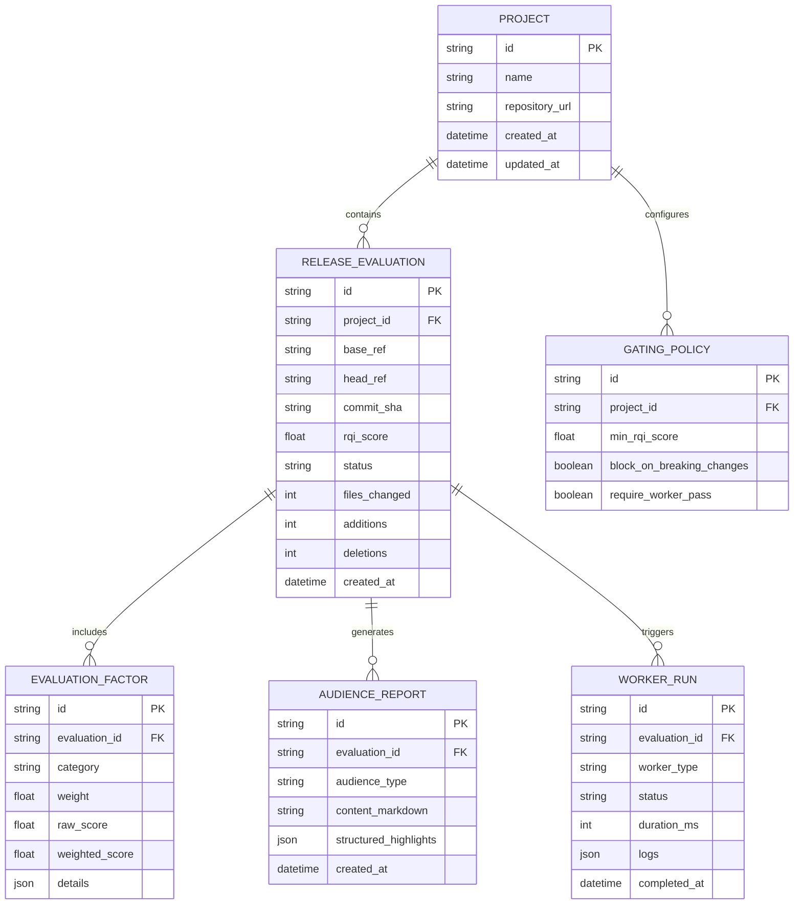

# Data Model & Schema — ReleaseLens

> **Document Status**: `INITIAL BASELINE` / `PROPOSED`  
> **Last Synchronized**: 2026-11-03  

---

## 1. Entity-Relationship Overview

---

## 2. Key Entity Definitions

1. **`Project`**: Represents an ingested software repository or tracked workspace.
2. **`ReleaseEvaluation`**: A discrete evaluation of a release candidate (e.g. tag `v1.2.0`, PR #42, or commit range `main..staging`). Stores aggregate RQI score and metrics.
3. **`EvaluationFactor`**: Component scores contributing to the overall RQI score (Code Churn, Migration Risk, Security Impact, Test Coverage Delta).
4. **`AudienceReport`**: Tailored synthesis outputs generated for Engineering, Product, or Customer audiences.
5. **`WorkerRun`**: Execution record of automated cloud/browser smoke verification passes.
6. **`GatingPolicy`**: Rules determining whether an evaluation passes, warns, or blocks release progression.
