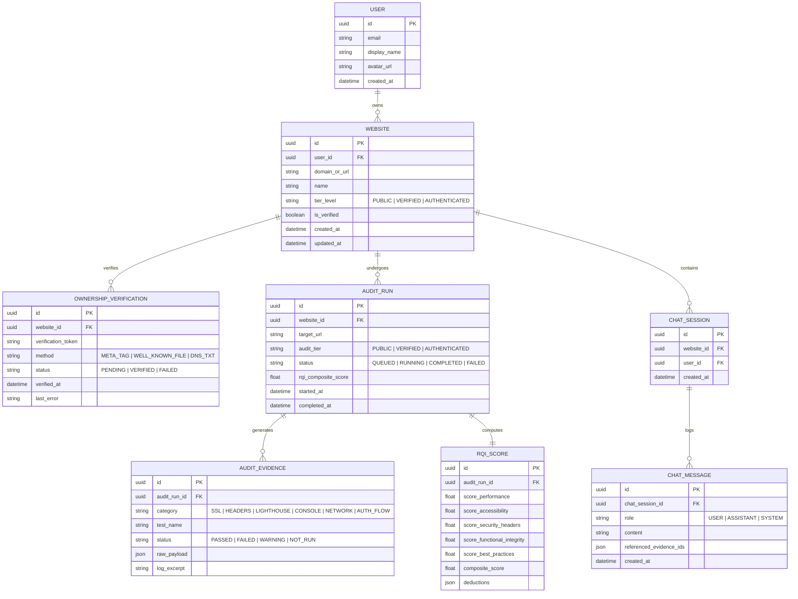

# Data Model & Schema — ReleaseLens

> **Document Status**: `SYNCHRONIZED`  
> **Last Synchronized**: 2026-11-03  

---

## 1. Entity-Relationship Overview

---

## 2. Row-Level Security (RLS) Rules (Supabase / Postgres)

1. **`WEBSITE`**: Users can only insert, select, update, or delete websites where `user_id = auth.uid()`.
2. **`AUDIT_RUN` & `RQI_SCORE`**: Access strictly bounded to the owner of the parent `website_id` (or publicly viewable if the owner flags a specific report as public).
3. **`CHAT_SESSION` & `CHAT_MESSAGE`**: Restricted strictly to the authenticated `user_id`.
