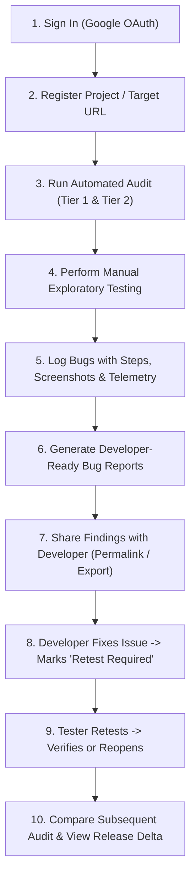

# Product Requirements Document (PRD) — ReleaseLens

> **Document Status**: `SYNCHRONIZED` / `RESET TO TESTING & BUG DISCOVERY PLATFORM`  
> **Last Synchronized**: 2026-11-03  
> **Target Release**: MVP v0.1.0  

---

## 1. Executive Summary

**ReleaseLens** is a cloud-hosted **Web Application Testing, Bug Discovery, Evidence Collection, and Release-Readiness Platform**.

It bridges the painful gap between quality assurance and software development by empowering testers, QA engineers, and hackathon builders to:
1. Register web applications across production, staging, and preview environments (including `*.vercel.app` preview deployments).
2. Execute automated quality audits (availability, TLS, security headers, broken links, HTTP status codes, performance).
3. Conduct structured manual exploratory testing, logging bugs with reproduction steps, environment telemetry, and evidence.
4. Generate developer-ready bug reports with clear reproduction steps, technical evidence, and actionable next steps.
5. Track issues through a verification lifecycle (`Open` $\to$ `Acknowledged` $\to$ `In Progress` $\to$ `Fixed` $\to$ `Retest Required` $\to$ `Verified` / `Reopened`).
6. Measure release health via the **ReleaseLens Quality Index (RQI)** and track regression deltas across retests.
7. Consult an evidence-grounded, read-only AI assistant to synthesize bug briefs and interpret test results without hallucinations.

---

## 2. Target Personas & Core User Journeys

### 2.1 Target Personas
- **The QA / Hackathon Tester (Primary Persona)**: Exploring new builds, discovering broken forms, broken buttons, authentication drops, and layout defects; needs to quickly log bugs with evidence and hand them to developers.
- **The Full-Stack Developer**: Needs reproducible bug reports with environment details, exact failure steps, and clear verification criteria—not vague Slack messages.
- **The Tech Lead / Release Manager**: Needs an objective Release-Readiness verdict (RQI) combining automated test health and manual exploratory bug counts before promoting code to production.

### 2.2 End-to-End User Journey

---

## 3. Detailed MVP Feature Specifications

### Module A: Authentication & Workspace
- **Google OAuth Sign-In**: Powered by Supabase Auth with secure HTTP-only cookies.
- **User Projects**: Users create and own projects (e.g. "E-Commerce Hackathon App").
- **Environment Tagging**: Support `PRODUCTION`, `STAGING`, and `PREVIEW` environments.
- **Tenant Isolation**: Row-Level Security (RLS) ensures users only access their own projects, audits, and bug reports.

### Module B: Project Registration
- Project name and target URL (full support for custom domains and `*.vercel.app` preview URLs).
- Authorized testing scope definition (bounds URL crawling to the declared domain).
- Historical audit log and active bug list per project.

### Module C: Automated Website Testing
Bounded, evidence-backed automated checks:
- **Availability & HTTP Status**: Server uptime and response code.
- **TLS & HTTPS**: Certificate validity, expiration countdown, HTTPS enforcement.
- **Security Headers**: HSTS, CSP, X-Frame-Options, X-Content-Type-Options, Referrer-Policy, Permissions-Policy.
- **Broken Links & Navigation**: Internal link crawler detecting 404/500 routes up to 15 pages.
- **Performance & Vitals**: Core Web Vitals and Lighthouse metrics via Google PageSpeed Insights REST API.
- **Accessibility & Metadata**: Mobile viewport, title, robots.txt, basic ARIA sanity.
- **Standard State Output**: Every automated check reports strictly `PASS`, `FAIL`, `NOT_RUN`, or `INCONCLUSIVE`.

### Module D: Manual Exploratory Testing (Core MVP Feature)
Structured bug logging interface allowing testers to record:
- **Bug Title & Description**.
- **Affected URL / Route**.
- **Steps to Reproduce** (ordered numbered list).
- **Expected Result vs. Actual Result**.
- **Severity**: `CRITICAL` (blocks core flow/auth), `HIGH` (feature broken), `MEDIUM` (functional flaw with workaround), `LOW` (cosmetic/minor).
- **Environment Telemetry**: Browser name/version, OS, screen viewport size, network type.
- **Evidence / Attachments**: Screenshot upload / image URL, error console snippet, network payload snippet.
- **Developer Notes & Workaround**: Optional notes to assist debugging.
- **Status Workflow**: `OPEN` $\to$ `ACKNOWLEDGED` $\to$ `IN_PROGRESS` $\to$ `FIXED` $\to$ `RETEST_REQUIRED` $\to$ `VERIFIED` (or `REOPENED`).

### Module E: Evidence & Developer Handoff
- Clean, structured bug summary view designed for engineers.
- Actionable next steps highlighted (e.g. *"Fix CORS header on `/api/login`"*, *"Correct Z-index on modal button"*).
- Shareable bug permalinks and export to Markdown / JSON.

### Module F: Retesting & Regression Comparison
- "Retest Bug" action: Tester directly validates whether a bug marked `FIXED` is genuinely resolved.
- Subsequent audit comparison: Automatically computes Release Delta ($\Delta$):
  - Change in RQI score.
  - Newly introduced broken links.
  - Regressed Core Web Vitals.
  - Count of newly opened vs. resolved bugs.

### Module G: Tripartite RQI (Release Quality Index)
Evidence-backed release readiness index combining:
1. **Hard Release Gates** (`PASS`, `FAIL`, `NOT_RUN`, `INCONCLUSIVE`):
   - Critical Security Gate (TLS valid, HTTPS enforced, Clickjacking protected).
   - Functional Bug Gate (Zero `CRITICAL` unresolved bugs).
2. **Tested Quality Score ($S_{\text{quality}}$)**: 0–100 score across executed automated checks and bug deductions.
3. **Audit Coverage Completeness ($C_{\text{audit}}$)**: Percentage of testable surface evaluated.
4. **Verdicts**: `VERIFIED_READY`, `PROVISIONAL_PASS`, `REVIEW_REQUIRED`, `RELEASE_BLOCKED`.

### Module H: Evidence-Grounded AI Assistant
- Read-only, toolless assistant (powered by Google Gemini Flash API via AI Studio free tier).
- Summarizes technical logs and formats developer bug reports.
- Distinguishes automated findings from tester-submitted exploratory bugs.
- Cites exact audit evidence; **never invents reproduction results or claims an unverified bug is fixed**.

---

## 4. Scope Boundaries & Deferred Features

### In Scope for MVP (v0.1.0)
- SaaS Web Application (Desktop browser + responsive mobile web).
- Modules A through H described above.
- Tier 1 & Tier 2 automated audits (PageSpeed API + Cloudflare Worker link crawler).

### Explicitly Deferred to Post-MVP (v0.2.0+)
- ⏳ Native desktop (Windows EXE, macOS DMG) or mobile (Android/iOS) apps.
- ⏳ Full automated headless authenticated browser testing (Cloud Run container worker).
- ⏳ Direct GitHub/Jira two-way issue sync.
- ⏳ Continuous 24/7 background cron monitoring.
- ⏳ Autonomous AI testing agents.
