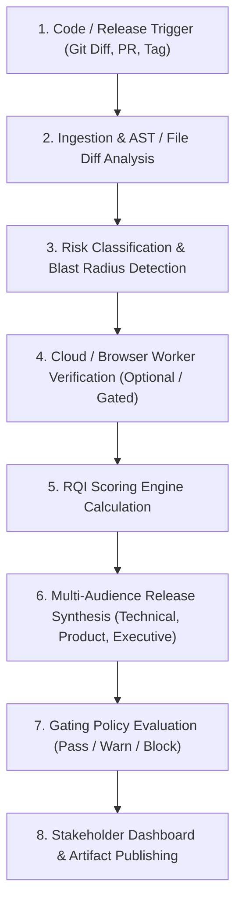

# ReleaseLens — Project Workflow & Operational Lifecycle

> **Document Status**: `INITIAL BASELINE`  
> **Last Synchronized**: 2026-11-03  

---

## 1. End-to-End System Workflow

---

## 2. Stage Breakdown

### Stage 1: Ingestion & Parsing
- Input: Git range (`commit_a..commit_b`), PR payload, or unified diff file.
- Action: Extracts metadata, commit messages, author list, altered files, additions/deletions, and hunk breakdowns.

### Stage 2: Structural Risk Analysis
- Identifies critical paths:
  - Database schema alterations (`/migrations/`, `schema.sql`, `prisma.schema`).
  - Authentication and authorization files (`/auth/`, `/middleware/`, security rules).
  - Package dependency updates (`package.json`, lockfiles).
  - API route definitions and contract modifications.

### Stage 3: Verification & Cloud Worker Passes
- Triggers isolated worker execution for:
  - Synthetic user journeys or headless browser checks.
  - Smoke tests and contract integrity.
  - Recording latency and health verification proofs.

### Stage 4: RQI Scoring Engine
- Computes the aggregate **Release Quality Index (RQI)** score [0-100].
- Formulates specific sub-scores (Stability, Test Health, Security/Blast Radius, Migration Risk).

### Stage 5: Stakeholder Output Generation
- Generates structured Markdown and JSON reports formatted for:
  - Engineers (raw technical breakdown, touched modules, test coverage delta).
  - Product Managers (business-value deliverables, user-facing behavior changes).
  - Customer Support & Marketing (release announcements, deprecation alerts).
