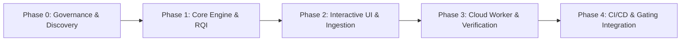

# Product & Engineering Roadmap — ReleaseLens

> **Document Status**: `INITIAL BASELINE`  
> **Last Synchronized**: 2026-11-03  

---

## Roadmap Phases

---

## Phase Details

### Phase 0: Inception, Governance & Discovery Baseline (`IN PROGRESS`)
- [x] Permanent documentation governance established (`AGENTS.md`).
- [x] Initial repository documentation baseline structured.
- [ ] Complete Discovery Interview (Stage 1 through Stage 6) with User.
- [ ] Synthesize confirmed `docs/PROJECT_SPEC.md`.

### Phase 1: Core Intelligence Engine & RQI Scoring (`PLANNED`)
- [ ] Diff parsing and metadata extraction module.
- [ ] High-risk path and blast radius classification.
- [ ] Deterministic RQI (Release Quality Index) calculation engine.
- [ ] Core unit test suite validating scoring idempotency and accuracy.

### Phase 2: Interactive Web Application & Audience Synthesis (`PLANNED`)
- [ ] Modern, high-density Web UI (Next.js / React / Tailwind / Radix).
- [ ] Visual RQI score gauges, risk factors, and file trees.
- [ ] Audience-specific views: Engineering, Product, and Executive summaries.
- [ ] Exportable artifacts (Markdown, JSON, HTML).

### Phase 3: Cloud / Browser Worker Execution (`PLANNED`)
- [ ] Isolated execution harness for synthetic smoke tests.
- [ ] Headless browser validation runner with screenshot capture.
- [ ] Worker health reporting and test evidence ingestion.

### Phase 4: Integrations, Gating & Production Readiness (`PROPOSED`)
- [ ] GitHub App / Action integration for automated PR checks.
- [ ] Webhook triggers and release sign-off gating rules.
- [ ] End-to-end audit and deployment guide.
