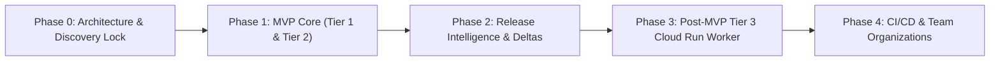

# Product & Engineering Roadmap — ReleaseLens

> **Document Status**: `SYNCHRONIZED` / `FINAL SPECIFICATION (ROUND 5)`  
> **Last Synchronized**: 2026-11-03  

---

## 1. Roadmap Overview

---

## 2. Milestone Deliverables

### Phase 0: Discovery, Architecture Validation & Governance (`COMPLETE`)
- [x] Documentation governance established (`AGENTS.md`).
- [x] Cloud Run pricing and regional capacity factually corrected (Round 5).
- [x] Vercel Hobby fair-use compliance validated (crawling decoupled to Cloudflare Workers).
- [x] Tripartite RQI Hard-Gate Model defined.
- [x] Pre-implementation doubt discovery and self-audit finalized.

### Phase 1: MVP Core Engine (v0.1.0) (`PLANNED — Awaiting Approval`)
- [ ] Google OAuth sign-in with Supabase SSR session handling.
- [ ] Website onboarding (custom domains and `*.vercel.app` preview URLs).
- [ ] Ownership verification engine (HTML `<meta>` tag and `/.well-known/releaselens-verify.txt`).
- [ ] Tier 1 Public Inspection: TLS/SSL validity, security headers, Google PageSpeed lab metrics.
- [ ] Tier 2 Verified Inspection: Cloudflare Worker internal link crawler (detects 404s up to 15 pages).
- [ ] Tripartite RQI calculation engine with 4-state hard gates (`PASS`, `FAIL`, `NOT_RUN`, `INCONCLUSIVE`).

### Phase 2: Release Deltas, Dashboards & Evidence AI (v0.1.0) (`PLANNED`)
- [ ] Modern high-density Web Dashboard (Next.js 15, Tailwind CSS, Radix UI).
- [ ] Release Delta ($\Delta$) comparison view (flags score drops $>5$ pts, vital regressions, newly missing headers).
- [ ] Evidence-grounded conversational AI assistant (Google Gemini Flash via AI Studio free tier).
- [ ] Report export (Markdown, JSON, copyable permalink).
- [ ] Comprehensive unit and integration test suite recorded in `docs/TEST_RESULTS.md`.

### Phase 3: Post-MVP Hardened Browser Worker (v0.2.0) (`DEFERRED`)
- [ ] Google Cloud Run isolated container runner with Linux `iptables` kernel egress firewall.
- [ ] Experimental verification of WebRTC UDP drops and subresource IP pinning.
- [ ] Automated headless Chromium console error trapping and OAuth redirect probing.

### Phase 4: CI/CD Gating & Multi-User Teams (v0.3.0) (`PROPOSED`)
- [ ] GitHub App / Action webhook gating integration.
- [ ] Multi-user organization RBAC.
- [ ] Automated scheduled audit crons.
