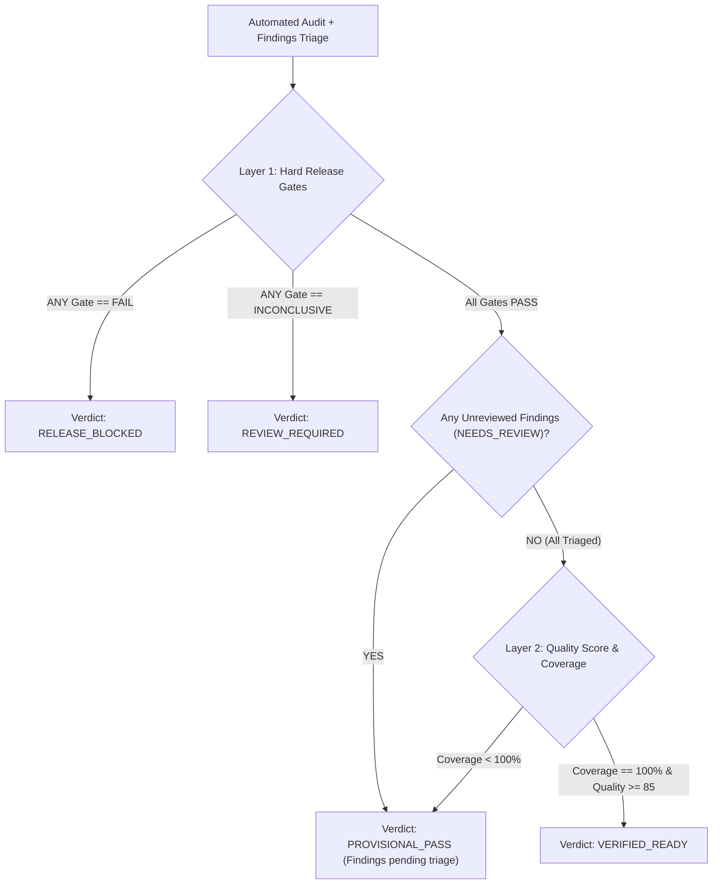

# ReleaseLens Quality Index (RQI) — Tripartite Governance Model

> **Document Status**: `SYNCHRONIZED` / `AUTOMATE FIRST, HUMAN REVIEW SECOND`  
> **Last Synchronized**: 2026-11-03  

---

## 1. Tripartite Governance Architecture

RQI evaluates release health by unifying **automated audit results**, **findings triage status**, and **confirmed exploratory defects** across three independent layers:
1. **Layer 1: Independent Hard Release Gates** (`PASS`, `FAIL`, `NOT_RUN`, `INCONCLUSIVE`).
2. **Layer 2: Tested Quality Score ($S_{\text{quality}}$)** (0–100 score factoring automated metrics and confirmed bug deductions).
3. **Layer 3: Audit Coverage Completeness ($C_{\text{audit}}$)** (0–100% evaluated test surface).

---

## 2. Layer 1: Independent Hard Release Gates

| Hard Gate | Scope | Evaluated Criteria | Blocker Condition (`FAIL`) |
| :--- | :--- | :--- | :--- |
| **`GATE_SECURITY`** | Automated Tier 1 | TLS validity, HTTPS enforcement, Clickjacking protection. | TLS expired ($\le 0$ days), imminent expiry ($\le 2$ days), plain HTTP without redirect, or missing clickjacking protection. |
| **`GATE_FUNCTIONAL`** | Automated + Confirmed Bugs | Critical broken routes + Confirmed Exploratory Bugs. | **One or more unresolved `CONFIRMED` critical bugs exist**, or critical broken routes detected. |

> **CRITICAL RULE**: Potential findings (`DETECTED` / `NEEDS_REVIEW`) do NOT automatically block the release. Only **`CONFIRMED` critical bugs** or failing automated checks trigger `GATE_FUNCTIONAL = FAIL` $\to$ **`RELEASE_BLOCKED`**.

---

## 3. Layer 2: Tested Quality Score ($S_{\text{quality}}$)

Calculated over executed automated categories and adjusted for **`CONFIRMED` active bugs**:

$$S_{\text{quality}} = \max\left(0, \frac{\sum_{i \in T} w_i \cdot S_i}{\sum_{i \in T} w_i} - D_{\text{confirmed\_bugs}} - P_{\text{minor}}\right)$$

### Automated Category Allocation:
- Security & Headers ($w_1 = 0.25$)
- Performance & Vitals ($w_2 = 0.25$)
- Accessibility & SEO ($w_3 = 0.15$)
- Broken Links & Navigation ($w_4 = 0.35$)
- Total $W = 1.00$.

### Confirmed Bug Deductions ($D_{\text{confirmed\_bugs}}$):
- **`CRITICAL` Bug**: Triggers `GATE_FUNCTIONAL = FAIL` $\to$ `RELEASE_BLOCKED`.
- **`HIGH` Severity Bug**: -15 points per confirmed open issue.
- **`MEDIUM` Severity Bug**: -5 points per confirmed open issue.
- **`LOW` Severity Bug**: -2 points per confirmed open issue.
- *(Findings in `NEEDS_REVIEW`, `REJECTED`, or `DUPLICATE` apply ZERO score deduction).*

---

## 4. Layer 3: Audit Coverage ($C_{\text{audit}}$)

$$C_{\text{audit}} = \sum_{i \in T} w_i \times 100\%$$

- **Tier 1 Only**: $C_{\text{audit}} = 0.25 + 0.25 + 0.15 = \mathbf{65\%}$
- **Tier 1 + Tier 2 (Link Crawl)**: $C_{\text{audit}} = 0.65 + 0.35 = \mathbf{100\%}$

---

## 5. Release Verdict Matrix

| Release Verdict | Gate Status | Unreviewed Findings | Quality ($S_{\text{quality}}$) | Coverage ($C_{\text{audit}}$) | Operational Meaning |
| :--- | :--- | :--- | :--- | :--- | :--- |
| **`VERIFIED_READY`** | All Gates PASS | **0** (All triaged) | $\ge 85$ | $100\%$ | All automated checks passed; all findings triaged; zero confirmed critical/high bugs; verified production ready. |
| **`PROVISIONAL_PASS`** | All Gates PASS | $\ge 1$ (Or $C < 100\%$) | $\ge 85$ | Any | No blockers detected, but unreviewed findings exist or deep tiers were omitted. |
| **`REVIEW_REQUIRED`** | All Gates PASS | Any | $70 \le S_{\text{quality}} < 85$ | Any | Non-critical warnings, performance bottlenecks, or confirmed medium bugs. |
| **`RELEASE_BLOCKED`** | **ANY Gate FAILS** | Any | Any (or $< 70$) | Any | **Deploy blocked**. Expired certificate or confirmed unresolved critical bug. |
