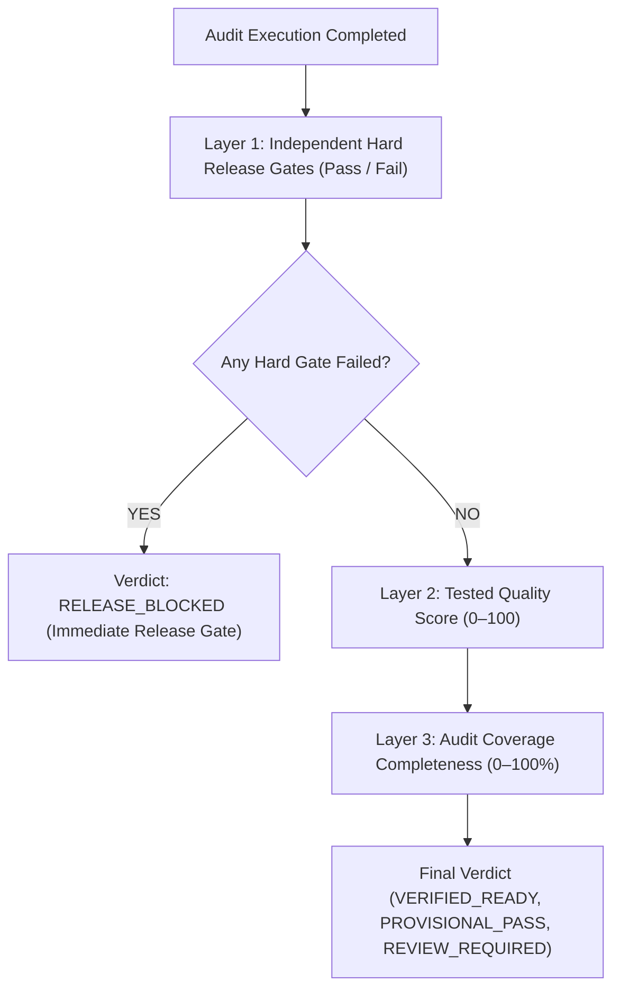

# ReleaseLens Quality Index (RQI) — Tripartite Governance Model

> **Document Status**: `SYNCHRONIZED` / `VALIDATED SPECIFICATION (ROUND 3)`  
> **Last Synchronized**: 2026-11-03  

---

## 1. Tripartite Governance Architecture

ReleaseLens rejects naive numerical averaging that allows high performance to mask critical security flaws, or mathematical formulas that award 50% scores to unrun audits. 

RQI is structured into three independent evaluation layers:

---

## 2. Layer 1: Independent Hard Release Gates

Before computing numerical scores, the engine evaluates three critical binary gates:

1. **Security Gate**:
   - TLS certificate valid and unexpired ($>14$ days remaining).
   - HTTPS enforced (HTTP requests redirect to HTTPS).
   - Anti-clickjacking protection active (`X-Frame-Options: DENY|SAMEORIGIN` or `frame-ancestors`).
2. **Functional Gate**:
   - Zero unhandled JavaScript exceptions crashing page load.
   - Initial DOM hydration completes without unhandled fatal error.
3. **Auth Gate (when Tier 3 is configured)**:
   - Configured OAuth callback route is reachable and deployed (returns HTTP 400 or redirect, not 404 or 500).
   - OAuth redirect parameters contain valid client ID and well-formed redirect URI.

> **CRITICAL RULE**: If **ANY** Hard Release Gate fails, the release status is immediately set to **`RELEASE_BLOCKED`**, regardless of whether other categories scored 100%.

---

## 3. Layer 2: Tested Quality Score ($S_{\text{quality}}$)

Calculated strictly over the set of categories actually executed ($T \subseteq \{1, 2, 3, 4, 5\}$):

$$S_{\text{quality}} = \frac{\sum_{i \in T} w_i \cdot S_i}{\sum_{i \in T} w_i} - P_{\text{minor}}$$

Where:
- $w_i$ represents category weights.
- $S_i \in [0, 100]$ represents category sub-scores.
- $P_{\text{minor}}$ represents non-blocking deductions (e.g. missing `Referrer-Policy`: -5 pts).
- **If no categories were tested ($T = \emptyset$), $S_{\text{quality}} = 0$ (Undefined).**

### Category Weight Allocation:
- **1. Security & Header Hygiene ($w_1 = 0.25$)** [Tier 1]
- **2. Performance & Core Web Vitals ($w_2 = 0.25$)** [Tier 1]
- **3. Accessibility & SEO ($w_3 = 0.15$)** [Tier 1]
- **4. Functional Integrity & Internal Links ($w_4 = 0.20$)** [Tier 2]
- **5. Auth Contracts & Route Gates ($w_5 = 0.15$)** [Tier 3]

---

## 4. Layer 3: Audit Coverage Completeness ($C_{\text{audit}}$)

Evaluates what percentage of the total test surface was evaluated:

$$C_{\text{audit}} = \sum_{i \in T} w_i \times 100\%$$

- **Tier 1 Only**: $C_{\text{audit}} = 0.25 + 0.25 + 0.15 = \mathbf{65\%}$
- **Tier 1 + Tier 2**: $C_{\text{audit}} = 0.65 + 0.20 = \mathbf{85\%}$
- **Full Tier 1 + 2 + 3**: $C_{\text{audit}} = 0.85 + 0.15 = \mathbf{100\%}$

---

## 5. Release Verdict Classification Rules

| Release Verdict | Gate Status | Quality Score ($S_{\text{quality}}$) | Coverage ($C_{\text{audit}}$) | Operational Meaning |
| :--- | :--- | :--- | :--- | :--- |
| **`VERIFIED_READY`** | All Gates PASS | $\ge 85$ | $\ge 80\%$ | Fully verified release candidate; high confidence for production deployment. |
| **`PROVISIONAL_PASS`** | All Gates PASS | $\ge 85$ | $< 80\%$ | High quality on public scans, but deeper functional or auth checks were not executed. |
| **`REVIEW_REQUIRED`** | All Gates PASS | $70 \le S_{\text{quality}} < 85$ | Any | Non-critical warnings, performance bottlenecks, or missing secondary headers. |
| **`RELEASE_BLOCKED`** | **ANY Gate FAILS** | Any (or $< 70$) | Any | **Deploy blocked**. Critical security flaw, page-crashing JS exception, or broken auth route. |

---

## 6. Concrete Worked Examples

### Example 1: Full Audit (All Gates Passed)
- Hard Gates: Security PASS, Functional PASS, Auth PASS.
- Tested: All 5 categories ($C_{\text{audit}} = 100\%$).
- Category Scores: $S_1 = 92$, $S_2 = 88$, $S_3 = 95$, $S_4 = 90$, $S_5 = 100$. Deductions: $P_{\text{minor}} = 0$.
- $S_{\text{quality}} = (0.25 \times 92) + (0.25 \times 88) + (0.15 \times 95) + (0.20 \times 90) + (0.15 \times 100) = \mathbf{92.3}$.
- **Display**: Quality Score: **92.3 / 100** | Coverage: **100%** | Verdict: **`VERIFIED_READY`**.

---

### Example 2: Tier 1 Public Scan Only
- Hard Gates: Security PASS, Functional (Not Run), Auth (Not Run).
- Tested: Categories 1, 2, 3 ($C_{\text{audit}} = 65\%$).
- Category Scores: $S_1 = 90$, $S_2 = 86$, $S_3 = 92$. Deductions: $P_{\text{minor}} = 0$.
- Tested weight sum = $0.65$.
- $S_{\text{quality}} = \frac{(0.25 \times 90) + (0.25 \times 86) + (0.15 \times 92)}{0.65} = \frac{57.8}{0.65} = \mathbf{88.9}$.
- **Display**: Quality Score: **88.9 / 100** | Coverage: **65%** | Verdict: **`PROVISIONAL_PASS`** *(Notice: Deeper functional and auth tiers unverified)*.

---

### Example 3: High Performance but Broken Hard Security Gate
- Target has 100% Core Web Vitals ($S_2 = 100$), but serves an expired TLS certificate and lacks `X-Frame-Options` ($S_1 = 30$).
- Hard Security Gate: **FAILS** (Expired TLS certificate).
- **Result**: Regardless of whether $S_{\text{quality}}$ computes to 65 or 75, the release is immediately flagged as **`RELEASE_BLOCKED`**. The user cannot deploy under false security.

---

### Example 4: Audit with Provider Outage / Inconclusive Checks
- Google PageSpeed times out; Security ($S_1 = 90$), Accessibility ($S_3 = 95$), and Functional ($S_4 = 90$) pass. Performance is marked `INCONCLUSIVE`.
- Hard Gates: All PASS.
- Tested: Categories 1, 3, 4 ($C_{\text{audit}} = 0.25 + 0.15 + 0.20 = 60\%$).
- Tested weight sum = $0.60$.
- $S_{\text{quality}} = \frac{(0.25 \times 90) + (0.15 \times 95) + (0.20 \times 90)}{0.60} = \frac{22.5 + 14.25 + 18.0}{0.60} = \frac{54.75}{0.60} = \mathbf{91.3}$.
- **Display**: Quality Score: **91.3 / 100** | Coverage: **60%** | Verdict: **`PROVISIONAL_PASS`** *(Alert: Performance metrics unavailable)*.
