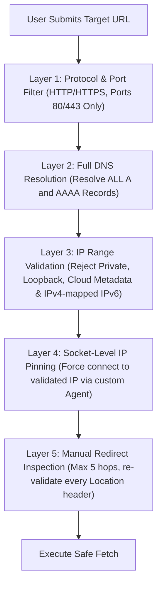

# Security Architecture & Authorization Rules — ReleaseLens

> **Document Status**: `SYNCHRONIZED` / `REVISED SPECIFICATION`  
> **Last Synchronized**: 2026-11-03  

---

## 1. Ethical & Legal Auditing Boundaries

ReleaseLens enforces strict rules to prevent misuse as a denial-of-service tool or unauthorized vulnerability scanner:

1. **URL Submission Is NOT Authorization**:
   - Submitting a URL grants permission **only** for Tier 1 (Public, passive inspection: standard HTTP `GET` requests, public Google PageSpeed queries, and public SSL handshake).
2. **Mandatory Proof of Ownership for Active Tests (Tier 2 & 3)**:
   - Deep crawls, broken link scanning, automated form checks, or authenticated flows **require active domain ownership verification**.
3. **Verification Mechanisms & Origin Integrity**:
   - **HTML Meta Tag**: `<meta name="releaselens-verification" content="rl_verify_<256_bit_token>">`
   - **Well-Known Verification File**: `https://<origin>/.well-known/releaselens-verify.txt` (Instant verification for Vercel/Next.js/SPA preview deployments).
   - **DNS TXT Record**: `_releaselens-challenge.<domain>` with value `rl_verify_<256_bit_token>`.
   - **Origin Matching & Redirect Policy**: Verification strictly requires origin matching (protocol, host, port). Same-domain HTTP to HTTPS redirects are allowed; **cross-domain redirects are rejected**. Verification challenges expire after 7 days if unverified.
4. **Credential Isolation**:
   - For Tier 3 authenticated testing, test credentials must never be shared in chat or committed to git. They are encrypted at rest using AES-GCM-256 with keys stored in cloud environment variables.

---

## 2. Comprehensive SSRF & DNS Rebinding Defense-in-Depth

Auditing user-submitted URLs exposes the backend to severe Server-Side Request Forgery risks. ReleaseLens implements a 5-layer mitigation pipeline:

### Layer 1: Protocol & Port Filtering
- Allowed schemes: strictly `http://` and `https://` (HTTPS required for Tier 2/3).
- Prohibited schemes: `file:`, `gopher:`, `ftp:`, `data:`, `blob:`, `ldap:`, `dict:`.
- Allowed destination ports: strictly `80` and `443`. All other ports are rejected.

### Layer 2 & 3: DNS Validation & IP Blacklisting
Before establishing any network connection:
- Resolve all A and AAAA records via `dns.promises.lookup(hostname, { all: true })`.
- If **any** returned IP address matches the following blacklists, the request is immediately aborted:
  - Loopback: `127.0.0.0/8`, `::1`
  - Private networks (RFC 1918): `10.0.0.0/8`, `172.16.0.0/12`, `192.168.0.0/16`
  - Carrier-grade NAT: `100.64.0.0/10`
  - Link-local: `169.254.0.0/16`, `fe80::/10`
  - Cloud Metadata Services: `169.254.169.254`, `metadata.google.internal`, `100.100.100.100`
  - IPv4-mapped IPv6: `::ffff:127.0.0.1`, `::ffff:169.254.169.254`, `::ffff:10.0.0.0/104`
  - Broadcast & Multicast: `224.0.0.0/4`, `255.255.255.255/32`, `ff00::/8`

### Layer 4: Socket-Level DNS Pinning (Anti-Rebinding)
- Attackers exploit DNS rebinding by answering with a public IP on initial DNS query, then serving `127.0.0.1` milliseconds later when the HTTP client initiates connection.
- **Mitigation**: ReleaseLens utilizes a custom `http.Agent` / `https.Agent` that pins the socket connection directly to the IP address verified in Layer 3, passing the domain name exclusively in the HTTP `Host` header and TLS Server Name Indication (SNI). This physically guarantees zero re-query between validation and connection.

### Layer 5: Strict Manual Redirect Interception
- Native HTTP clients must never have `redirect: 'follow'` enabled.
- All HTTP 3xx responses are intercepted manually. The `Location` header is parsed:
  - Maximum redirect depth: 5 hops.
  - Cross-protocol downgrade (HTTPS -> HTTP) is immediately blocked.
  - The redirect destination target must independently pass Layers 1, 2, 3, and 4 before the next hop is requested.

---

## 3. Crawler Scope & Abuse Containment

1. **Origin Boundary**: Link spidering is strictly bounded to `URL.origin`. All outbound/external links are recorded as external targets but never traversed.
2. **Resource Constraints**:
   - Max crawl depth: 2 hops from root.
   - Max pages audited per run: 15 pages.
   - Request delay: Minimum 100ms between requests to prevent overwhelming the target server.
   - Max HTML download size: 2MB per page.
