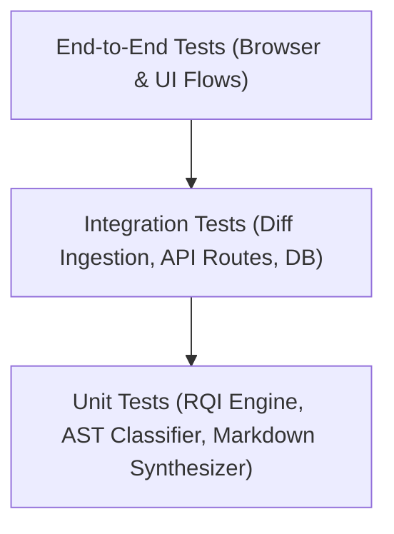

# Test Strategy & Quality Plan — ReleaseLens

> **Document Status**: `INITIAL BASELINE`  
> **Last Synchronized**: 2026-11-03  

---

## 1. Testing Philosophy

Testing in ReleaseLens adheres to the principle of **Empirical Verification**:
1. **Zero Fabricated Checks**: No test will ever be recorded as passed in documentation or reports unless actually executed and observed in the environment.
2. **Contract-First Testing**: API endpoints, parser outputs, and worker outputs must be bounded by strict schema validations.
3. **Deterministic Scoring Validation**: The RQI calculation engine must be tested against edge cases (zero churn, massive diffs, breaking schema alterations, missing CI metrics) to guarantee idempotency and mathematical stability.

---

## 2. Test Pyramid & Scope

| Layer | Tools (Proposed) | Target Scope |
| :--- | :--- | :--- |
| **Unit Testing** | Vitest / Jest | RQI formulas, diff chunk parsing, risk heuristic classification |
| **Integration Testing** | Supertest / Node Test Runner | API endpoint contracts, policy evaluation, schema persistence |
| **E2E / Browser Testing** | Playwright | Full user journey: Upload diff -> view score -> toggle audience tabs -> export |
| **Security Testing** | Static analysis / Dependency audit | Secret leak prevention, path traversal checks on diff parsing |
